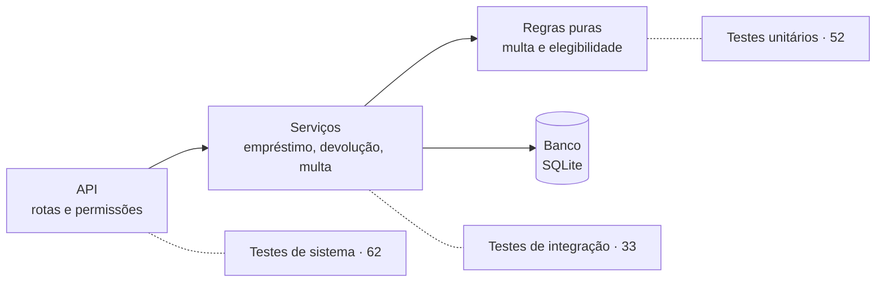

# Plano de Teste de Software: API de Biblioteca

[](https://github.com/Brenooryan/Plano_de_Teste_de_Software/actions/workflows/ci.yml)
[](https://github.com/Brenooryan/Plano_de_Teste_de_Software/actions/workflows/seguranca.yml)

Plano de teste completo para uma API REST de biblioteca acadêmica, do planejamento à execução: especificação de requisitos testáveis, 147 testes automatizados em três níveis, pipeline de integração contínua com quality gates, teste de carga com k6 e análise dinâmica de segurança com OWASP ZAP.

**Resultado:** a versão 1.0.0 (commit `af9663c`) passou nos 7 critérios de aceitação, com 147 testes aprovados, 98,6% de cobertura combinada e nenhum defeito crítico aberto. Os testes encontraram 4 defeitos; 3 foram corrigidos e verificados por reexecução.

## Sobre o projeto

### O que é

Este repositório reúne duas coisas que se completam:

1. **Um plano de teste de software completo.** É o trabalho principal. O plano define o que será testado e o que fica de fora, com que estratégia, técnicas e ferramentas, quais critérios decidem se o sistema passou e quais riscos ameaçam a qualidade. Depois, registra a execução real: casos de teste com evidências, defeitos encontrados, correções, métricas e uma análise crítica dos resultados.
2. **O sistema-alvo do plano.** Uma API REST de biblioteca acadêmica, em Python com FastAPI, que o próprio grupo especificou e construiu para servir de objeto dos testes.

O foco é o **processo de teste**. A API existe para ser testada, e o valor do projeto está em mostrar como cada decisão de teste foi tomada e o que ela encontrou.

### Objetivo

**Objetivo geral:** elaborar e executar um plano de teste completo para um sistema de software, aplicando práticas profissionais de engenharia de testes, do planejamento estratégico à execução controlada dos casos de teste, com análise crítica dos resultados obtidos.

**Objetivos específicos:**

- verificar a correção das regras de negócio (multa, limites, prazos e a decisão de emprestar), inclusive nos valores de fronteira;
- garantir a consistência dos dados: um exemplar nunca pode estar em dois empréstimos ativos, nem sob requisições simultâneas;
- verificar a segurança de login e de acesso: credenciais inválidas, token vencido ou adulterado, perfil sem permissão e leitura de dados de outro usuário precisam ser barrados;
- verificar a interoperabilidade dos módulos: uma devolução atrasada gera multa, e a multa bloqueia o próximo empréstimo até o pagamento;
- medir o desempenho sob carga e a resistência a ataques comuns (OWASP Top 10).

### Para que foi feito

É o projeto final (**Avaliação 2: Projeto Final de Disciplina, Plano de Teste de Software**) da disciplina **Qualidade de Software**, do curso de Engenharia da Computação do **UNISAL** (Centro Universitário Salesiano de São Paulo), com o professor Warner. O objetivo da avaliação é demonstrar domínio das técnicas estudadas, senso crítico sobre o processo de verificação e validação, e decisões fundamentadas para mitigar riscos de qualidade.

Os entregáveis pedidos são: relatório técnico em PDF, apresentação, planilha com os testes executados e código dos testes automatizados. Todos estão neste repositório (seção 11).

**Por que uma API de biblioteca?**

- É um domínio que qualquer pessoa entende, sem precisar de conhecimento técnico de uma área específica.
- As regras têm números e fronteiras claros (3 ou 5 livros, 7 ou 14 dias, R$ 1,00 por dia com teto de R$ 30,00), ideais para análise do valor limite e tabela de decisão.
- As falhas teriam consequências reais: financeira (multa cobrada errado), de privacidade (dados pessoais de alunos expostos, com implicação na LGPD) e de consistência (um livro emprestado a duas pessoas).

**Por que construir o próprio sistema?** Com acesso ao código, o grupo combinou testes de caixa-branca (unitários e medição de cobertura) com testes de caixa-preta (sistema, carga e segurança), corrigiu os defeitos encontrados e reexecutou os testes para provar cada correção.

**Integrantes:** Breno Ryan de Andrade Fernandes, Daniel Marton, João Vitor Azevedo e Mariana Freitas.

## Sumário

1. [O sistema testado](#1-o-sistema-testado)
2. [Tecnologias](#2-tecnologias)
3. [Estrutura do repositório](#3-estrutura-do-repositório)
4. [Como rodar no seu computador](#4-como-rodar-no-seu-computador)
5. [Como usar a API](#5-como-usar-a-api)
6. [Como executar os testes automatizados](#6-como-executar-os-testes-automatizados)
7. [Testes não funcionais: carga e segurança](#7-testes-não-funcionais-carga-e-segurança)
8. [Pipeline de integração contínua](#8-pipeline-de-integração-contínua)
9. [Como o projeto foi feito](#9-como-o-projeto-foi-feito)
10. [Resultados](#10-resultados)
11. [Documentação e evidências](#11-documentação-e-evidências)
12. [Problemas comuns](#12-problemas-comuns)

---

## 1. O sistema testado

A API gerencia o acervo, os empréstimos, as devoluções e as multas de uma biblioteca acadêmica. Não há interface gráfica: o uso é por requisições HTTP, documentadas automaticamente em OpenAPI (Swagger).

| Perfil | Empréstimo | O que mais pode fazer |
|---|---|---|
| Aluno | Até 3 livros por 7 dias | Consultar o acervo e os próprios empréstimos e multas |
| Professor | Até 5 livros por 14 dias | O mesmo que o aluno |
| Bibliotecário | Não realiza | Registrar devoluções e pagamentos de multa; consultar os dados de todos |

**Regras principais:**

- A multa é de R$ 1,00 por dia corrido de atraso, limitada a R$ 30,00 por empréstimo.
- Qualquer multa pendente bloqueia novos empréstimos até o pagamento.
- Para emprestar, quatro condições precisam ser atendidas: conta ativa, nenhuma multa pendente, abaixo do limite de empréstimos e exemplar disponível.
- O token de acesso vale 30 minutos.

A especificação completa, com 34 requisitos funcionais, 11 não funcionais, parâmetros e máquinas de estado, está em [`docs/requisitos.md`](docs/requisitos.md).

### Endpoints

| Método | Rota | Quem pode usar |
|---|---|---|
| `GET` | `/health` | Público |
| `POST` | `/auth/login` | Público |
| `GET` | `/usuarios/eu` | Qualquer usuário autenticado |
| `GET` | `/livros` | Qualquer usuário autenticado |
| `POST` | `/emprestimos` | Aluno ou professor |
| `POST` | `/devolucoes` | Bibliotecário |
| `GET` | `/usuarios/{usuario_id}/emprestimos` | O próprio usuário ou o bibliotecário |
| `GET` | `/usuarios/{usuario_id}/multas` | O próprio usuário ou o bibliotecário |
| `POST` | `/multas/{multa_id}/pagamento` | Bibliotecário |

### Usuários de demonstração

Na primeira vez que a API sobe, ela cria o banco `biblioteca.db` com estes usuários e com 5 livros de 2 exemplares cada:

| Perfil | E-mail | Senha |
|---|---|---|
| Bibliotecário | `bibliotecario@biblioteca.local` | `biblio1234` |
| Aluno | `aluno@biblioteca.local` | `aluno1234` |
| Professor | `professor@biblioteca.local` | `professor1234` |

> As senhas acima são apenas de demonstração. Em um sistema real, nenhuma credencial ficaria no código-fonte.

---

## 2. Tecnologias

| Ferramenta | Versão | Uso |
|---|---|---|
| Python | 3.11 e 3.12 | Linguagem (as duas versões são testadas no pipeline) |
| FastAPI | 0.136.3 | Framework da API, validação e Swagger |
| Uvicorn | 0.34.0 | Servidor que executa a API |
| SQLAlchemy | 2.0.51 | Acesso ao banco de dados (ORM) |
| SQLite | (incluso no Python) | Banco de dados |
| PyJWT | 2.15.0 | Tokens de acesso (JWT) |
| scrypt | (biblioteca padrão) | Hash das senhas |
| pytest + pytest-cov | 9.0.3 / 7.1.0 | Testes automatizados e cobertura |
| httpx | 0.28.1 | Cliente HTTP usado pelo `TestClient` do FastAPI |
| ruff | 0.16.9 | Análise estática: erros prováveis, estilo e segurança |
| k6 | — | Teste de carga e de concorrência |
| OWASP ZAP | 2.17.0 | Análise dinâmica de segurança (DAST) |
| GitHub Actions | — | Integração contínua e quality gates |

---

## 3. Estrutura do repositório

```text
Plano_de_Teste_de_Software/
├── app/                      # Código da API
│   ├── main.py               # Ponto de entrada: cria a aplicação e registra as rotas
│   ├── config.py             # Todos os parâmetros das regras (limites, prazos, multa)
│   ├── regras/               # Regras de negócio PURAS (sem banco, rede ou relógio)
│   ├── services/             # Casos de uso: empréstimo, devolução, multa (usam o banco)
│   ├── models/               # Tabelas do banco (SQLAlchemy)
│   ├── schemas/              # Formato das entradas e saídas da API (Pydantic)
│   ├── api/                  # Rotas, permissões, tratamento de erros e cabeçalhos
│   ├── database.py           # Conexão com o SQLite
│   ├── seguranca.py          # Hash de senha (scrypt) e tokens (JWT)
│   ├── relogio.py            # Único ponto que lê a data atual (trocado nos testes)
│   └── dados_iniciais.py     # Usuários e livros de demonstração
├── tests/
│   ├── unit/                 # 52 casos: regras puras, hash e token
│   ├── integration/          # 33 casos: serviços com banco, estados e concorrência
│   └── system/               # 62 casos: a API por HTTP, permissões e fluxos completos
├── perf/carga.js             # Teste de carga e de concorrência (k6)
├── scripts/resumo_seguranca.py  # Quality gate 3: lê o relatório do ZAP e o log da API
├── .github/workflows/
│   ├── ci.yml                # Quality gates 1 e 2: análise estática, testes e cobertura
│   └── seguranca.yml         # Quality gate 3: scan dinâmico com OWASP ZAP
├── docs/
│   ├── requisitos.md         # Especificação de requisitos (v1.0)
│   ├── Relatorio_Tecnico_Plano_de_Teste_API_Biblioteca.pdf
│   ├── Relatorio_Tecnico_Plano_de_Teste_API_Biblioteca.docx
│   └── Planilha_de_Testes_API_Biblioteca.xlsx
├── evidencias/               # Saídas reais das execuções (E01 a E14)
├── requirements.txt          # Dependências, com versões fixas
├── pytest.ini                # Configuração do pytest
└── ruff.toml                 # Configuração da análise estática
```

### Arquitetura

O código é dividido em camadas, e cada camada tem um nível de teste natural:



As regras de negócio ficam em funções puras, que recebem tudo por parâmetro, inclusive a data de hoje. Por isso elas podem ser testadas sem banco, sem servidor e sem esperar dias para simular um atraso.

---

## 4. Como rodar no seu computador

### Pré-requisitos

| Programa | Obrigatório? | Para quê | Como verificar |
|---|---|---|---|
| [Python 3.11 ou 3.12](https://www.python.org/downloads/) | Sim | Rodar a API e os testes | `python --version` |
| [Git](https://git-scm.com/downloads) | Sim | Baixar o repositório | `git --version` |
| [k6](https://grafana.com/docs/k6/latest/set-up/install-k6/) | Não | Teste de carga (seção 7) | `k6 version` |
| [Docker](https://docs.docker.com/get-docker/) | Não | Scan de segurança local (seção 7) | `docker --version` |

> **Windows:** ao instalar o Python, marque a opção **“Add python.exe to PATH”**. Sem ela, o comando `python` não é reconhecido no terminal.

### Passo 1: baixar o projeto

```bash
git clone https://github.com/Brenooryan/Plano_de_Teste_de_Software.git
cd Plano_de_Teste_de_Software
```

### Passo 2: criar o ambiente virtual

O ambiente virtual (`.venv`) é uma instalação do Python só deste projeto. Assim, as versões das bibliotecas daqui não se misturam com as de outros projetos do seu computador.

**Windows (PowerShell):**

```powershell
python -m venv .venv
.venv\Scripts\Activate.ps1
```

**Linux ou macOS:**

```bash
python3 -m venv .venv
source .venv/bin/activate
```

Com o ambiente ativado, o terminal mostra `(.venv)` no início da linha. **Todos os comandos a partir daqui supõem o ambiente ativado.** Se você fechar o terminal, ative de novo com o segundo comando acima.

> Se o PowerShell recusar o `Activate.ps1` com um erro de “execução de scripts desabilitada”, rode uma vez `Set-ExecutionPolicy -Scope CurrentUser RemoteSigned` e tente de novo.

### Passo 3: instalar as dependências

```bash
python -m pip install --upgrade pip
python -m pip install -r requirements.txt
```

As versões ficam fixas no `requirements.txt`, então você instala exatamente o que foi testado.

### Passo 4: subir a API

```bash
python -m uvicorn app.main:app --reload
```

Quando aparecer `Application startup complete`, a API está no ar em `http://127.0.0.1:8000`. O `--reload` reinicia o servidor sozinho quando você altera o código. Para parar, use `Ctrl + C`.

Para conferir, abra no navegador:

- `http://127.0.0.1:8000/health`: deve responder `{"status":"ok"}`.
- `http://127.0.0.1:8000/docs`: a documentação interativa (Swagger).

> Use sempre `python -m uvicorn` (e `python -m pytest`, `python -m ruff`). Assim, o comando roda com o Python do ambiente virtual, e não com outro instalado no computador.

### Passo 5 (quando precisar): voltar ao estado inicial

A API grava os dados no arquivo `biblioteca.db`, na raiz do projeto. Para recomeçar do zero, pare a API, apague o arquivo e suba de novo: os dados de demonstração são recriados.

```powershell
# Windows (PowerShell)
Remove-Item biblioteca.db
```

```bash
# Linux ou macOS
rm biblioteca.db
```

O arquivo está no `.gitignore` e nunca vai para o repositório.

---

## 5. Como usar a API

### Pelo Swagger (mais fácil)

1. Com a API no ar, abra `http://127.0.0.1:8000/docs`.
2. Em **POST /auth/login**, clique em **Try it out** e envie:

   ```json
   { "email": "aluno@biblioteca.local", "senha": "aluno1234" }
   ```

3. Copie o valor de `access_token` da resposta.
4. Clique em **Authorize** (cadeado, no topo da página), cole o token e confirme. Cole só o token, sem a palavra `Bearer`.
5. Agora as rotas protegidas funcionam. Experimente:
   - **GET /livros**: lista o acervo e os ids dos exemplares;
   - **POST /emprestimos** com `{ "exemplar_id": 1 }`: empresta o exemplar 1;
   - **GET /usuarios/eu**: mostra os seus dados, incluindo o seu id.

O token vale 30 minutos. Depois disso, as rotas respondem 401 e é preciso fazer login de novo.

### Pelo terminal

**Windows (PowerShell):**

```powershell
$login = Invoke-RestMethod -Method Post -Uri http://127.0.0.1:8000/auth/login `
  -ContentType "application/json" `
  -Body '{"email": "aluno@biblioteca.local", "senha": "aluno1234"}'
$cabecalho = @{ Authorization = "Bearer $($login.access_token)" }

Invoke-RestMethod -Uri http://127.0.0.1:8000/livros -Headers $cabecalho
Invoke-RestMethod -Method Post -Uri http://127.0.0.1:8000/emprestimos -Headers $cabecalho `
  -ContentType "application/json" -Body '{"exemplar_id": 1}'
```

**Linux ou macOS:**

```bash
TOKEN=$(curl -s -X POST http://127.0.0.1:8000/auth/login \
  -H "Content-Type: application/json" \
  -d '{"email": "aluno@biblioteca.local", "senha": "aluno1234"}' \
  | python3 -c "import json, sys; print(json.load(sys.stdin)['access_token'])")

curl -s http://127.0.0.1:8000/livros -H "Authorization: Bearer $TOKEN"
curl -s -X POST http://127.0.0.1:8000/emprestimos \
  -H "Authorization: Bearer $TOKEN" -H "Content-Type: application/json" \
  -d '{"exemplar_id": 1}'
```

### Códigos de resposta

| Código | Significado |
|---|---|
| 200 / 201 | Sucesso (201: empréstimo criado) |
| 401 | Não autenticado: token ausente, inválido ou expirado |
| 403 | Autenticado, mas o perfil não tem permissão para a operação |
| 404 | Recurso não encontrado |
| 409 | Regra de negócio recusou: limite atingido, multa pendente, exemplar indisponível… |
| 422 | Dado inválido: campo ausente, tipo errado ou id fora da faixa válida |

> A multa só aparece quando um livro é devolvido com atraso. Como a API usa a data real, não dá para simular dias de atraso pelo Swagger; esse cenário é coberto pelos testes automatizados, que usam um relógio controlado (veja a seção 9).

---

## 6. Como executar os testes automatizados

Não é preciso subir a API: os testes criam um banco novo em memória para cada teste e chamam a API internamente.

### Suíte completa

```bash
python -m pytest
```

Resultado esperado: `147 passed`. Leva cerca de 20 segundos; o teste de concorrência é o mais demorado.

Para ver o nome de cada teste: `python -m pytest -v`.

### Por nível de teste

```bash
python -m pytest tests/unit          # 52 casos, menos de 1 segundo
python -m pytest tests/integration   # 33 casos
python -m pytest tests/system        # 62 casos
```

### Um arquivo ou um teste específico

```bash
python -m pytest tests/unit/test_multas.py
python -m pytest -k "limite"         # só os testes com "limite" no nome
```

### Cobertura de código

```bash
python -m pytest --cov=app --cov-branch --cov-report=term-missing
```

O relatório mostra, por arquivo, a cobertura de linhas e de decisões (`--cov-branch`: cada `if` precisa ser exercitado nos dois sentidos) e as linhas não cobertas. Resultado esperado: cerca de 98–99% no total.

Para um relatório navegável, com cada linha colorida:

```bash
python -m pytest --cov=app --cov-branch --cov-report=html
```

Depois, abra `htmlcov/index.html` no navegador.

Para reproduzir exatamente o quality gate do pipeline, que reprova abaixo de 80%:

```bash
python -m pytest --cov=app --cov-branch --cov-fail-under=80
```

### Análise estática

```bash
python -m ruff check .
```

Resultado esperado: `All checks passed!`. As regras ativas estão em `ruff.toml`: erros prováveis, estilo, armadilhas comuns e segurança (as mesmas regras da ferramenta bandit).

### Teste de concorrência (regressão do DEF-01)

O teste `tests/integration/test_concorrencia.py` dispara 20 pedidos simultâneos pelo mesmo exemplar, em 20 threads, sobre um banco em arquivo, e confere que só um é aceito. Ele roda 3 vezes dentro da suíte. Para repetir várias vezes, como o grupo fez para confirmar a correção:

```powershell
# Windows (PowerShell): 5 execuções
1..5 | ForEach-Object { python -m pytest tests/integration/test_concorrencia.py -q }
```

```bash
# Linux ou macOS: 5 execuções
for i in 1 2 3 4 5; do python -m pytest tests/integration/test_concorrencia.py -q; done
```

---

## 7. Testes não funcionais: carga e segurança

### Teste de carga com k6

O roteiro [`perf/carga.js`](perf/carga.js) roda três cenários em sequência, em cerca de 3 minutos:

| Cenário | Carga | O que verifica |
|---|---|---|
| `leitura` | 50 usuários consultando o acervo por 2 minutos | RNF01: 95% das consultas em menos de 500 ms, menos de 1% de erros |
| `login` | 10 usuários fazendo login sem pausa por 30 segundos | Custo do login (hash scrypt) |
| `concorrencia` | 20 usuários emprestando o **mesmo** exemplar ao mesmo tempo | RNF05: um exemplar, um único empréstimo |

**Passo 1: instale o k6**, conforme o [guia oficial](https://grafana.com/docs/k6/latest/set-up/install-k6/). Por exemplo, `winget install k6 --source winget` no Windows ou `brew install k6` no macOS.

**Passo 2: suba a API com o banco recém-criado**, em um terminal. Sem `--reload`, para medir o servidor como ele roda de fato:

```powershell
# Windows (PowerShell)
Remove-Item biblioteca.db -ErrorAction SilentlyContinue
python -m uvicorn app.main:app
```

```bash
# Linux ou macOS
rm -f biblioteca.db
python -m uvicorn app.main:app
```

O banco precisa estar limpo porque o cenário de concorrência usa o aluno de demonstração: se ele já tiver empréstimos de uma execução anterior, os pedidos podem ser recusados pelo limite e o resultado não vale. O roteiro se recusa a rodar quando não há exemplar disponível, mas não detecta um aluno com empréstimos antigos, então apague o banco antes de **cada** execução.

**Passo 3: rode o teste**, em outro terminal, na pasta do projeto:

```bash
k6 run perf/carga.js
```

No resumo final, procure:

- `tempo_consulta ... p(95)=`: deve ficar abaixo de 500 ms (o grupo mediu entre 14 e 18 ms);
- `emprestimos_aceitos ... 1`: exatamente um empréstimo aceito no cenário de concorrência;
- as linhas `VERIFICACAO RNF05` e `VERIFICACAO RF15`, que conferem o que ficou gravado no banco;
- os ✓ nos `thresholds`: se algum critério falhar, o k6 termina com erro.

Para rodar de novo, repita o passo 2 (apague o banco e suba a API).

### Análise de segurança com OWASP ZAP

O scan roda automaticamente no GitHub Actions a cada push (workflow `seguranca.yml`), e esse é o caminho usado pelo grupo. Para ver o resultado:

1. Abra a aba **Actions** do repositório.
2. Escolha o workflow **Segurança (DAST)** e a execução desejada.
3. No resumo da execução, a tabela de alertas por nível de risco e a distribuição das respostas da API aparecem na própria página.
4. Em **Artifacts**, baixe `relatorios-de-seguranca`, com o relatório completo do ZAP (HTML, Markdown e JSON) e o log da API.

Para disparar sem fazer push, use **Run workflow** na mesma página.

**Rodar no seu computador (opcional, Linux ou macOS com Docker):** os comandos abaixo repetem os passos do workflow.

```bash
# Terminal 1: suba a API gravando o log de acesso
rm -f biblioteca.db
python -m uvicorn app.main:app > uvicorn.log 2>&1

# Terminal 2: obtenha um token e rode o scan
TOKEN=$(curl -s -X POST http://localhost:8000/auth/login \
  -H "Content-Type: application/json" \
  -d '{"email": "bibliotecario@biblioteca.local", "senha": "biblio1234"}' \
  | python3 -c "import json, sys; print(json.load(sys.stdin)['access_token'])")
mkdir -p zap && chmod 777 zap
docker run --rm --network host -v "$PWD/zap:/zap/wrk:rw" \
  -e ZAP_AUTH_HEADER_VALUE="Bearer $TOKEN" \
  ghcr.io/zaproxy/zaproxy:stable \
  zap-api-scan.py -t http://localhost:8000/openapi.json -f openapi \
  -r relatorio-zap.html -J relatorio-zap.json -I

# Quality gate 3: nenhum alerta alto e nenhuma resposta 5xx
python scripts/resumo_seguranca.py zap/relatorio-zap.json uvicorn.log
```

> No Windows com Docker Desktop, o modo `--network host` não funciona da mesma forma. Nesse caso, prefira o workflow do GitHub Actions.

---

## 8. Pipeline de integração contínua

Dois workflows rodam a cada push e aplicam três quality gates. Se qualquer gate falha, o commit fica marcado como reprovado (✗ vermelho) no GitHub.

| Gate | Workflow | Critério de parada | Ferramenta |
|---|---|---|---|
| 1. Análise estática | `ci.yml` | Qualquer ocorrência das regras E, W, F, B e S | ruff |
| 2. Testes e cobertura | `ci.yml` | Qualquer teste reprovado, ou cobertura combinada abaixo de 80% | pytest + pytest-cov, em Python 3.11 **e** 3.12 |
| 3. Segurança | `seguranca.yml` | Qualquer alerta de risco alto, ou qualquer resposta 5xx durante o ataque | OWASP ZAP + `scripts/resumo_seguranca.py` |

Para reproduzir os gates 1 e 2 antes de fazer push:

```bash
python -m ruff check .
python -m pytest --cov=app --cov-branch --cov-fail-under=80
```

O enunciado cita o SonarQube como exemplo de quality gate. O grupo aplicou os mesmos dois critérios, cobertura mínima e análise estática, com ferramentas que rodam dentro do próprio pipeline, sem depender de um serviço externo.

---

## 9. Como o projeto foi feito

### Processo

1. **Requisitos testáveis antes do código.** A especificação ([`docs/requisitos.md`](docs/requisitos.md)) define cada regra com números e fronteiras: limites, prazos, valores e estados. Os critérios de aceitação foram fixados antes de qualquer execução.
2. **Desenvolvimento em camadas, com testes junto.** Cada módulo foi escrito com os seus testes: primeiro as regras puras (unitários), depois os serviços com banco (integração), depois as rotas (sistema).
3. **Pipeline cedo.** Com a suíte funcional pronta, o pipeline passou a rodar a cada push.
4. **Testes não funcionais contra a API no ar:** carga com k6 e scan de segurança com ZAP.
5. **Ciclo de defeitos: reproduzir, corrigir, verificar.** Para cada defeito, primeiro um teste que falha, depois a correção, depois a reexecução de toda a suíte.

### Técnicas de projeto de testes

| Técnica | Onde foi aplicada |
|---|---|
| Partição de equivalência | Perfis, faixas de dias de atraso, tipos de token (válido, ausente, adulterado, vencido…) e dono do recurso |
| Análise do valor limite | Limites de 3 e 5 empréstimos (testados em 2/3/4 e 4/5/6), multa em 0, 1, 29, 30 e 31 dias de atraso, ids em 0 e no maior inteiro do SQLite |
| Tabela de decisão | As 16 combinações das 4 condições para emprestar |
| Testes baseados em estados | Exemplar disponível → emprestado → disponível; usuário ativo → bloqueado → ativo; e as transições inválidas |
| Concorrência | 20 pedidos simultâneos pelo mesmo exemplar (k6 e threads) |

### Dublês de teste

Três componentes reais são substituídos durante os testes automatizados:

- **o banco em arquivo**, por um banco SQLite em memória, novo a cada teste;
- **o relógio do sistema**, por um relógio controlado, o que permite simular dias de atraso sem esperar (RNF11);
- **a sessão da API**, trocada por injeção de dependência (`dependency_overrides` do FastAPI), sem alterar as rotas.

### Defeitos encontrados

| ID | Defeito | Severidade | Encontrado por | Status |
|---|---|---|---|---|
| DEF-01 | Pedidos simultâneos geravam vários empréstimos ativos do mesmo exemplar | Crítica | Teste de carga (k6) | Corrigido: trava de escrita do banco (`BEGIN IMMEDIATE`) antes da leitura |
| DEF-02 | Identificador acima da capacidade do banco causava erro 500 | Média | Valor limite projetado à mão | Corrigido: faixa válida declarada, resposta 422 |
| DEF-03 | Mensagens de erro de validação (422) em inglês | Baixa | Avaliação da usabilidade da API | **Aberto**: recomendação de correção |
| DEF-04 | Cabeçalhos de segurança ausentes nas respostas | Baixa | OWASP ZAP | Corrigido: middleware adiciona os cabeçalhos |

O DEF-01 é o achado mais importante: os testes funcionais usam um banco em memória com uma única conexão, que força as operações a acontecerem uma de cada vez. Por isso, mesmo com cobertura alta, a suíte nunca executava o código em paralelo, e o defeito só apareceu no teste de carga.

---

## 10. Resultados

| Critério de aceitação | Meta | Medido |
|---|---|---|
| Casos de criticidade alta aprovados | 100% | 100% (19 de 19) |
| Casos de teste detalhados aprovados | No mínimo 95% | 95,8% (23 de 24) |
| Testes automatizados aprovados | 100% | 100% (147 de 147) |
| Cobertura combinada de código | No mínimo 80% | 98,6% |
| Alertas de risco alto no scan de segurança | Nenhum | 0 nas duas execuções |
| p95 da consulta com 50 usuários | Abaixo de 500 ms | 17,43 ms no pior caso |
| Defeitos críticos abertos | Nenhum | 0 |

**Os 7 critérios foram atendidos.**

---

## 11. Documentação e evidências

| Arquivo | Conteúdo |
|---|---|
| [`docs/Relatorio_Tecnico_Plano_de_Teste_API_Biblioteca.pdf`](docs/Relatorio_Tecnico_Plano_de_Teste_API_Biblioteca.pdf) | Relatório técnico completo (também em `.docx`) |
| [`docs/Planilha_de_Testes_API_Biblioteca.xlsx`](docs/Planilha_de_Testes_API_Biblioteca.xlsx) | 24 casos de teste detalhados, testes automatizados, rastreabilidade, riscos, defeitos, métricas e evidências |
| [`docs/requisitos.md`](docs/requisitos.md) | Especificação de requisitos v1.0 |
| [`evidencias/`](evidencias/) | Saídas reais das execuções, referenciadas no relatório e na planilha |

| Evidência | O que mostra |
|---|---|
| E01 | Execução final da suíte: 147 testes aprovados |
| E02 e E03 | Cobertura antes e depois de fechar as duas lacunas de decisão |
| E04 a E06 | As três execuções do teste de carga (k6) |
| E07 e E08 | Teste de concorrência antes e depois da correção do DEF-01 |
| E09 | Testes de identificador falhando antes da correção do DEF-02 |
| E10 e E11 | As duas execuções do scan de segurança (ZAP): relatório, resumo e log da API |
| E12 | Uso de CPU durante os cenários de leitura e de login |
| E13 | Execuções aprovadas no GitHub Actions |
| E14 | Mensagem de validação em inglês no Swagger (DEF-03) |
| E15 | Histórico de commits do repositório |

---

## 12. Problemas comuns

| Sintoma | Causa provável | Solução |
|---|---|---|
| `python` não é reconhecido (Windows) | O Python não foi adicionado ao PATH | Reinstale marcando **“Add python.exe to PATH”**, ou use `py` no lugar de `python` |
| `uvicorn` (ou `pytest`) não é reconhecido | O executável não está no PATH do terminal | Use `python -m uvicorn ...` e `python -m pytest` |
| `ModuleNotFoundError: No module named 'fastapi'` | O ambiente virtual não está ativado, ou as dependências não foram instaladas nele | Ative o `.venv` (passo 2) e rode `python -m pip install -r requirements.txt` |
| O PowerShell bloqueia o `Activate.ps1` | Política de execução de scripts do Windows | `Set-ExecutionPolicy -Scope CurrentUser RemoteSigned` |
| `address already in use` ao subir a API | A porta 8000 já está em uso, talvez por outra API aberta | Feche o outro terminal, ou use `--port 8001` |
| 401 em todas as rotas no Swagger | Token ausente ou expirado (vale 30 minutos) | Faça login de novo e atualize o **Authorize** |
| O k6 para com “Nenhum exemplar disponível” ou recusa todos os empréstimos | O banco já foi usado em uma execução anterior | Pare a API, apague `biblioteca.db` e suba de novo |
| Resultados de cobertura diferentes do esperado | Testes rodando com outro Python | Confira se o terminal mostra `(.venv)` e use `python -m pytest` |

---

### Limitações conhecidas

- O DEF-03 está aberto: os erros de validação (422) trazem a mensagem padrão do framework, em inglês.
- O SQLite foi adotado pela simplicidade; para produção, o relatório recomenda PostgreSQL.
- A chave que assina os tokens vem da variável de ambiente `BIBLIOTECA_CHAVE_SECRETA`. Sem ela, a API usa um valor padrão que serve **apenas** para desenvolvimento e testes.
- O módulo M5 (renovação e reserva) e os cadastros de usuários e livros estão especificados, mas ficaram fora do escopo de teste desta versão. As justificativas estão no relatório técnico.
